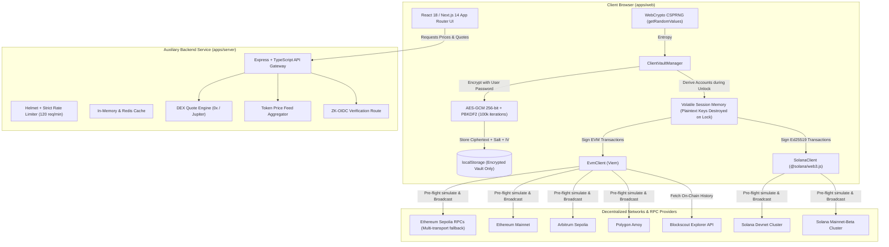

<div align="center">

# ⚡ Aetheris Wallet

**Production-Grade, Non-Custodial Multi-Chain Sovereign Crypto Wallet**

*Engineered with client-side cryptographic isolation, zero telemetry, testnet-first guardrails, and deterministic derivation across EVM and Solana ecosystems.*

---

[](https://github.com/aetheris/aetheris-wallet/actions)
[](https://www.typescriptlang.org/)
[](https://nextjs.org/)
[](https://viem.sh/)
[](https://solana.com/)
[](https://pnpm.io/)
[](https://opensource.org/licenses/MIT)

[Features](#-key-features) • [Architecture](#-architecture--data-flow) • [Tech Stack](#-tech-stack) • [Quickstart](#-quickstart--local-development) • [Environment Variables](#-environment-variables) • [Pre-Mainnet Audit Roadmap](#-pre-mainnet-audit-checklist)

</div>

---

## ⚠️ Pre-Mainnet Security Notice & Transparency Disclosure

> [!IMPORTANT]
> **TESTNET-FIRST POSTURE:** Neither this codebase nor any un-audited Web3 software is guaranteed to be 100% bug-free. Aetheris is **audit-ready** and engineered for **rigorous testnet validation** (Sepolia & Solana Devnet). Real user funds should **never** be committed to mainnet environments until an independent, third-party cryptographic security audit has been executed.

---

## 📖 Table of Contents

- [Overview](#-overview)
- [Key Features](#-key-features)
- [Architecture & Data Flow](#-architecture--data-flow)
- [Repository Structure](#-repository-structure)
- [Tech Stack](#-tech-stack)
- [Quickstart & Local Development](#-quickstart--local-development)
  - [Prerequisites](#prerequisites)
  - [1. Clone & Install](#1-clone-and-install)
  - [2. Environment Configuration](#2-environment-configuration)
  - [3. Run Development Servers](#3-run-development-servers)
  - [4. Docker Orchestration](#4-docker-orchestration)
- [Monorepo Commands & Scripts](#-monorepo-commands--scripts)
- [Cryptographic Vault Architecture](#-cryptographic-vault-architecture)
- [Supported Networks](#-supported-networks)
- [Pre-Mainnet Audit Checklist](#-pre-mainnet-audit-checklist)
- [Contributing](#-contributing)
- [License](#-license)

---

## 🌟 Overview

**Aetheris Wallet** is a sovereign, non-custodial cryptocurrency wallet designed to bridge the developer and user experience between the **Ethereum Virtual Machine (EVM)** and **Solana** ecosystems.

Unlike conventional browser extensions or custodial web wallets, Aetheris is architected with **strict client-side isolation**:
1. **Zero Server Custody:** Private keys, seed phrases, and decrypted key materials never leave the client's volatile memory.
2. **Encrypted at Rest:** Encrypted locally in browser storage using **256-bit AES-GCM** and **PBKDF2** (100,000 SHA-256 iterations) derived from the user's master password.
3. **Multi-Chain Derivation from 1 Seed:** A single 12-word BIP-39 mnemonic derives both EVM accounts (`m/44'/60'/0'/0/0`) and Solana Ed25519 accounts (`m/44'/501'/0'/0'`).
4. **Pre-Flight Execution Simulation:** Transfers and smart contract interactions undergo mandatory dry-run simulation (`eth_call` on EVM, `simulateTransaction` on Solana) to verify gas and execution validity prior to signing.
5. **No Telemetry / No Tracking:** Zero external analytics, session logging, or private key leakage.

---

## 🚀 Key Features

| Feature | Description |
| :--- | :--- |
| **Client-Side Cryptographic Vault** | Browser CSPRNG (`window.crypto.getRandomValues`) generating 128-bit entropy (12-word BIP-39 mnemonics). |
| **Cross-Chain Derivation** | Deterministic derivation of EVM accounts (Viem / `@scure/bip32`) and Solana keypairs (`@solana/web3.js` / `ed25519-hd-key`). |
| **AES-GCM WebCrypto Encryption** | Client-side password-based vault encryption with 256-bit AES-GCM, 16-byte random salt, 12-byte IV, and 100k PBKDF2 iterations. |
| **Tactile Network Slider** | Testnet-enforced switcher (Sepolia & Devnet by default). Mainnet switching requires conscious, affirmative user acknowledgment. |
| **RPC Fallback Transports** | Redundant EVM RPC pool (PublicNode, 1RPC, Tenderly, Ankr) using Viem's `fallback` transport to guarantee high availability. |
| **Pre-Flight Simulations** | Dry-run validation of every transfer before user signs, preventing failed transactions and wasted gas. |
| **DEX Swap Aggregator Staging** | Quoting engine integrated for EVM (0x / 1inch) and Solana (Jupiter) with real-time slippage tolerance adjustments (5 to 5000 bps). |
| **Fiat On/Off-Ramp Staging** | Integrated sandbox UI connectors for licensed fiat gateways (MoonPay & Transak). |
| **Zero-Knowledge Login (Auxiliary)** | Experimental Google OIDC ZK derivation endpoint preserving user privacy without exposing emails on-chain. |
| **Live On-Chain Transaction Feed** | Automatic balance polling and live Sepolia transaction history queryable via Blockscout API alongside local session records. |
| **Comprehensive Vitest Suite** | Cryptographic test cases verifying round-trip encryption, decryption failure handling, and multi-chain address derivation. |

---

## 🏗️ Architecture & Data Flow



---

## 📁 Repository Structure

```
Web3Wallet/
├── apps/
│   ├── web/                           # Next.js 14 Web Application
│   │   ├── src/
│   │   │   ├── app/                   # App Router layout, styling, and main dashboard
│   │   │   ├── components/            # Bespoke React UI components
│   │   │   │   ├── BalanceCard.tsx    # Native token balances, asset portfolio, quick actions
│   │   │   │   ├── Header.tsx         # Navigation, network pill, lock/unlock & ZK controls
│   │   │   │   ├── NetworkSlider.tsx  # Multi-chain network switcher with testnet safety
│   │   │   │   ├── SendModal.tsx      # Pre-flight validated token send modal
│   │   │   │   ├── ReceiveModal.tsx   # QR code generation & address clipboard
│   │   │   │   ├── SwapCard.tsx       # DEX aggregator swap interface with slippage controls
│   │   │   │   ├── DepositWithdrawModal.tsx # MoonPay / Transak sandbox ramps
│   │   │   │   ├── TransactionHistory.tsx   # On-chain Blockscout explorer & local tx logs
│   │   │   │   ├── SecurityChecklistCard.tsx# Audit-readiness checklist
│   │   │   │   └── ZkLoginModal.tsx   # Auxiliary OIDC ZK authentication flow
│   │   │   └── lib/
│   │   │       ├── chains/            # Viem (EVM) and @solana/web3.js client wrappers
│   │   │       │   ├── evm.ts         # EVM RPC client, multi-fallback, balance, simulate, send
│   │   │       │   └── solana.ts      # Solana connection, balance, simulate, send
│   │   │       └── crypto/            # Client cryptographic vault
│   │   │           ├── vault.ts       # BIP-39, HDKey, WebCrypto AES-GCM & PBKDF2
│   │   │           └── __tests__/     # Vitest cryptographic unit test suites
│   │   ├── tailwind.config.js         # Styling & design system tokens
│   │   └── tsconfig.json
│   │
│   └── server/                        # Express + TypeScript Auxiliary Coordinator
│       ├── src/
│       │   ├── routes/
│       │   │   ├── health.ts          # Uptime & health check endpoint
│       │   │   ├── prices.ts          # Cached multi-token spot pricing
│       │   │   ├── quotes.ts          # 0x / Jupiter swap quote synthesizer
│       │   │   └── zk.ts              # Google OIDC ZK proof verification endpoint
│       │   ├── services/
│       │   │   └── cache.ts           # In-memory TTL cache with Redis compatibility
│       │   ├── __tests__/             # Server route test suites
│       │   └── index.ts               # Express bootstrap, Helmet, CORS & rate limiters
│       ├── Dockerfile                 # Container image for backend service
│       └── tsconfig.json
│
├── packages/
│   └── common/                        # Shared Cross-Workspace TypeScript Package
│       ├── src/
│       │   ├── types/
│       │   │   ├── network.ts         # Chain configurations, RPC pools, testnet flags
│       │   │   ├── wallet.ts          # EncryptedVault, TokenBalance, TransactionRecord
│       │   │   └── swap.ts            # SwapQuote, SwapExecutionState interfaces
│       │   ├── index.ts               # Barrel exports
│       │   └── __tests__/             # Network and type guard validation tests
│       └── tsconfig.json
│
├── .github/
│   └── workflows/
│       └── ci.yml                     # Automated CI: lint, typecheck, Vitest, pnpm audit, build
├── docker-compose.yml                 # Orchestration for auxiliary server + Redis
├── pnpm-workspace.yaml                # pnpm monorepo workspace definition
├── package.json                       # Monorepo root scripts & dependencies
└── tsconfig.base.json                 # Shared TypeScript base configuration
```

---

## 💻 Tech Stack

### Frontend (`apps/web`)
- **Framework:** Next.js 14 (App Router) & React 18
- **Styling:** Tailwind CSS, PostCSS, Lucide React
- **EVM SDK:** Viem v2 (with fallback RPC transport, `eth_call` simulation, privateKeyToAccount)
- **Solana SDK:** `@solana/web3.js`, `bs58`, `ed25519-hd-key`
- **Key Derivation & Cryptography:** `@scure/bip39`, `@scure/bip32`, native WebCrypto API (AES-GCM, PBKDF2)
- **Utilities:** `qrcode.react`, `clsx`, `tailwind-merge`

### Auxiliary Backend (`apps/server`)
- **Runtime:** Node.js 20+ / 22+ with TypeScript (ES Modules via `tsx`)
- **Server Framework:** Express 4
- **Security:** Helmet, CORS, `express-rate-limit` (120 req/min/IP)
- **Validation:** Zod schemas
- **Caching:** In-memory TTL caching with Redis 7 support

### Shared Workspace (`packages/common`)
- **Shared Types:** TypeScript type definitions for chains, transactions, encrypted vaults, and swap quotes.
- **Network Configurations:** Standardized parameters for Sepolia, Ethereum Mainnet, Arbitrum Sepolia, Polygon Amoy, Solana Devnet, and Solana Mainnet.

### Tooling & DevOps
- **Package Manager:** `pnpm` (Workspace protocol)
- **Testing:** `vitest` (fast ESM-native unit testing)
- **Containerization:** Docker & Docker Compose
- **Continuous Integration:** GitHub Actions

---

## ⚡ Quickstart & Local Development

### Prerequisites

Make sure the following tools are installed on your machine:
- **Node.js:** `v20.x` or `v22.x` (LTS recommended)
- **pnpm:** `v9.x` or `v11.x` (`npm install -g pnpm`)
- **Git**
- *(Optional)* **Docker & Docker Compose** (for running Redis and containerized backend)

---

### 1. Clone and Install

```bash
# Clone the repository
git clone https://github.com/aetheris/aetheris-wallet.git
cd aetheris-wallet

# Install monorepo dependencies
pnpm install
```

---

### 2. Environment Configuration

Copy the example environment configuration file:

```bash
cp .env.example .env
```

The default values are pre-configured to work immediately with public RPC endpoints for **Ethereum Sepolia** and **Solana Devnet**.

---

### 3. Run Development Servers

You can start the frontend and backend in separate terminals:

```bash
# Terminal 1: Start Next.js frontend (http://localhost:3000)
pnpm dev

# Terminal 2: Start auxiliary backend service (http://localhost:4000)
pnpm dev:server
```

Alternatively, build all packages first and run:

```bash
pnpm build
```

Open your browser to [http://localhost:3000](http://localhost:3000) to access Aetheris Wallet.

---

### 4. Docker Orchestration

To run the backend coordinator and a Redis cache using Docker Compose:

```bash
# Start backend and Redis in the background
docker-compose up -d

# Verify container status
docker-compose ps

# View service logs
docker-compose logs -f
```

---

## 🔧 Environment Variables

Reference for configuration options in `.env`:

| Variable | Description | Default |
| :--- | :--- | :--- |
| `NEXT_PUBLIC_APP_NAME` | Display name of the application | `"Aetheris Wallet"` |
| `NEXT_PUBLIC_DEFAULT_NETWORK` | Default network loaded on initial visit | `"ethereum-sepolia"` |
| `NEXT_PUBLIC_API_URL` | Base URL of auxiliary backend server | `"http://localhost:4000/api"` |
| `NEXT_PUBLIC_SEPOLIA_RPC_URL` | Primary Ethereum Sepolia RPC URL | `"https://rpc.sepolia.org"` |
| `NEXT_PUBLIC_MAINNET_RPC_URL` | Primary Ethereum Mainnet RPC URL | `"https://eth.llamarpc.com"` |
| `NEXT_PUBLIC_ARBITRUM_SEPOLIA_RPC_URL` | Arbitrum Sepolia RPC endpoint | `"https://sepolia-rollup.arbitrum.io/rpc"` |
| `NEXT_PUBLIC_POLYGON_AMOY_RPC_URL` | Polygon Amoy testnet RPC endpoint | `"https://rpc-amoy.polygon.technology"` |
| `NEXT_PUBLIC_SOLANA_DEVNET_RPC_URL` | Solana Devnet cluster endpoint | `"https://api.devnet.solana.com"` |
| `NEXT_PUBLIC_SOLANA_MAINNET_RPC_URL` | Solana Mainnet-Beta cluster endpoint | `"https://api.mainnet-beta.solana.com"` |
| `ZEROX_API_KEY` | *(Optional)* 0x API key for high-throughput EVM quotes | `""` |
| `ONEINCH_API_KEY` | *(Optional)* 1inch API key for multi-chain routing | `""` |
| `JUPITER_API_KEY` | *(Optional)* Jupiter API key for Solana swaps | `""` |
| `NEXT_PUBLIC_MOONPAY_API_KEY` | *(Optional)* MoonPay sandbox/production public key | `""` |
| `NEXT_PUBLIC_TRANSAK_API_KEY` | *(Optional)* Transak sandbox/production API key | `""` |
| `PORT` | Auxiliary backend HTTP listening port | `4000` |
| `NODE_ENV` | Application environment mode | `"development"` |
| `CORS_ORIGIN` | Allowed cross-origin frontend origin | `"http://localhost:3000"` |
| `REDIS_URL` | Redis connection URI for caching | `"redis://localhost:6379"` |

---

## 📜 Monorepo Commands & Scripts

Run these commands from the root directory:

| Command | Action |
| :--- | :--- |
| `pnpm dev` | Starts the Next.js web application on port 3000 |
| `pnpm dev:server` | Starts the Express auxiliary server with live hot-reloading (`tsx`) |
| `pnpm build` | Compiles `@aetheris/common`, `@aetheris/server`, and `@aetheris/web` |
| `pnpm test` | Executes all unit and cryptographic test suites with Vitest |
| `pnpm typecheck` | Runs `tsc --noEmit` across all workspaces to enforce strict typing |
| `pnpm lint` | Runs Next.js ESLint checks |

---

## 🔐 Cryptographic Vault Architecture

Aetheris adheres to strict non-custodial cryptographic best practices:

### 1. Entropy & Key Derivation
- **Entropy Generation:** 128 bits generated via `window.crypto.getRandomValues(new Uint8Array(16))` mapped to 12 English BIP-39 words.
- **EVM Derivation Path:** Standard BIP-44 path `m/44'/60'/0'/0/0` producing secp256k1 keypairs.
- **Solana Derivation Path:** SLIP-0010 Ed25519 derivation path `m/44'/501'/0'/0'` producing Ed25519 keypairs.

### 2. Encryption at Rest (Client-Side)
```
User Passphrase
       │
       ▼
 [ PBKDF2 ] ◄── Salt (16 bytes CSPRNG) + 100,000 Iterations + SHA-256
       │
       ▼  (Derived 256-bit Key)
 [ AES-GCM ] ◄── IV (12 bytes CSPRNG)
       │
       ▼
 Encrypted Vault JSON Object:
 {
   "version": 1,
   "ciphertext": "<base64>",
   "iv": "<base64>",
   "salt": "<base64>",
   "kdfParams": { "algorithm": "PBKDF2", "iterations": 100000, "hash": "SHA-256" },
   "accounts": { "evmAddress": "0x...", "solanaAddress": "..." },
   "createdAt": 1727632800000
 }
```

### 3. Memory Lifecycle
- Private keys exist in volatile JavaScript heap variables **only while the wallet is actively unlocked**.
- Locking the wallet or refreshing/closing the browser purges all unencrypted keys.
- LocalStorage holds **only** the encrypted ciphertext, public addresses, IV, and salt.

---

## 🌐 Supported Networks

| Network Name | Family | Chain ID / Cluster | Type | Faucet URL | Block Explorer |
| :--- | :---: | :---: | :---: | :--- | :--- |
| **Ethereum Sepolia** *(Default)* | EVM | `11155111` | Testnet | [Sepolia Faucet](https://sepoliafaucet.com) | [Etherscan Sepolia](https://sepolia.etherscan.io) |
| **Solana Devnet** | Solana | `devnet` | Testnet | [Solana Faucet](https://faucet.solana.com) | [Solscan Devnet](https://solscan.io?cluster=devnet) |
| **Arbitrum Sepolia** | EVM | `421614` | Testnet | [Arbitrum Faucet](https://faucet.quicknode.com/arbitrum/sepolia) | [Arbiscan Sepolia](https://sepolia.arbiscan.io) |
| **Polygon Amoy** | EVM | `80002` | Testnet | [Polygon Faucet](https://faucet.polygon.technology) | [OKLink Amoy](https://www.oklink.com/amoy) |
| **Ethereum Mainnet** | EVM | `1` | Mainnet | N/A | [Etherscan](https://etherscan.io) |
| **Solana Mainnet-Beta** | Solana | `mainnet-beta` | Mainnet | N/A | [Solscan](https://solscan.io) |

---

## 📋 Pre-Mainnet Audit Checklist

Before releasing Aetheris on mainnets with real user funds:

- [ ] **Independent Cryptographic Audit:** Complete a formal review of `ClientVaultManager` by a reputable security firm (e.g., Trail of Bits, OpenZeppelin, OtterSec, Halborn).
- [ ] **Client Memory Penetration Testing:** Verify browser protection against memory scraping, malicious browser extensions, and prototype pollution.
- [ ] **Hardware Wallet & Passkey Integration:** Integrate WebAuthn / Passkeys and Ledger hardware signing via WebHID / WebUSB.
- [ ] **Smart Contract & Circuit Verification:** Rigorous formal verification of any swap routing proxies and ZK verification circuits.
- [ ] **Regulatory & Compliance Clearances:** Finalize Money Services Business (MSB) registrations and legal review for fiat on/off-ramp partners.
- [ ] **RPC Failover & Anti-DDoS Infrastructure:** Multi-vendor enterprise RPC pools (Alchemy, Infura, QuickNode) behind Cloudflare Enterprise WAF.
- [ ] **Immunefi Bug Bounty Program:** Deploy a public bug bounty program with high-tier incentives for vulnerability disclosure.

---

## 🤝 Contributing

Contributions are welcomed! Follow these steps to contribute:

1. **Fork the Repository** on GitHub.
2. **Create a Feature Branch:**
   ```bash
   git checkout -b feature/my-new-feature
   ```
3. **Commit Your Changes:**
   ```bash
   git commit -m "feat(vault): add support for hardware signer"
   ```
4. **Run Verification Suites:**
   ```bash
   pnpm typecheck
   pnpm test
   ```
5. **Push and Open a Pull Request:** Push to your fork and submit a PR to the `master` branch.

---

## 📄 License

This project is licensed under the **MIT License**. See the [LICENSE](LICENSE) file for details.

---

<div align="center">
<b>Aetheris Wallet</b> — Built for the sovereign Web3 generation.
</div>
